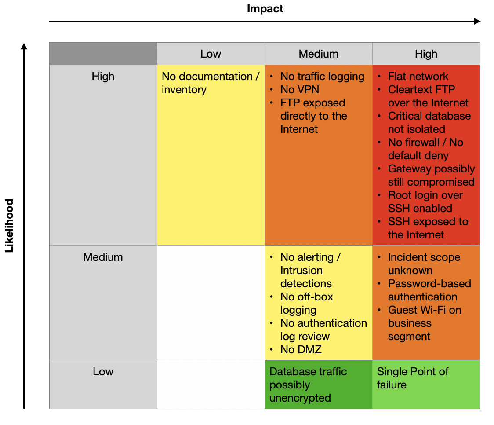

# Gap Analysis Report — LogiCorp Gateway Remediation

## 1. Executive Summary

LogiCorp's network currently has no internal barriers: a single unprotected gateway exposes administrative access to the entire Internet, and the critical shipping database sits on the same network as guest Wi-Fi devices. Combined with invoices and passwords travelling unencrypted over the Internet, this means one compromised device or stolen password can lead directly to the company's most critical data. We recommend an immediate containment phase this week, followed by network segmentation and encrypted remote access, all of which can be delivered without changing the legacy accounting software.

---
 

## 2. Current State Assessment

### 2.1 What the documentation tells us

| Area | Current State |
|---|---|
| **Topology** | Single Linux gateway (`eth0` WAN, `eth1` LAN) behind a modem, one switch serving all devices |
| **Addressing** | Flat network, single subnet `192.168.1.x` |
| **Segmentation** | None. Office PC, Finance PC, Guest Wi-Fi and critical Database share the same L2 segment |
| **Firewall** | No firewall active |
| **Remote administration** | SSH exposed to the whole Internet, root login enabled |
| **File transfer** | Cleartext FTP used by remote Accounting staff to upload invoices; client software cannot be changed |
| **Redundancy** | Single point of failure (out of scope) |
| **Documentation** | None reliable; the existing diagram is considered unreliable |
| **Incident history** | Security incident last week; contained but impact unknown |
| **Governance** | No dedicated security administrator for ~10 years; organic growth |

### 2.2 Documentation reliability

The As-Is diagram was drawn by a former intern and is flagged as likely inaccurate. The following points are **unverified** and must be confirmed on the live system:

- Whether the modem operates in bridge mode or performs routing/NAT itself (potential double NAT or bypass path).
- Whether the Wi-Fi access point is actually behind the gateway, or connected to the modem directly.
- The number of physical interfaces on the gateway and whether the switch supports VLANs (802.1Q).
- Where the FTP server runs (on the gateway itself or on an internal host).
- Which hosts and ports actually use the Database.
- Whether undocumented services, port forwards or devices exist.

---
 

## 3. Critical Gaps Identified

### 3.1 Network Architecture Gaps

|  | Current State | Target State | Gap / Risk |
|----|---|---|---|
| **NET-01** | Flat network, all devices in `192.168.1.x` | Network split into separate zones (Office/Finance, Database, Guest, DMZ if needed), inter-zone traffic filtered with default deny | Any compromised device can reach every other device, including the Database (lateral movement). |
| **NET-02** | Guest Wi-Fi on the same segment as business systems | Guest Wi-Fi isolated in its own zone with Internet access only | Untrusted, unmanaged devices have direct network access to the critical Database. |
| **NET-03** | Critical Database reachable by every host | Database in a restricted zone, reachable only by authorised hosts on its service port | The client's core business asset is not isolated, contrary to the CEO's explicit requirement. |
| **NET-04** | No DMZ; publicly needed services (e.g. FTP) hosted inside the LAN or on the gateway | No service exposed directly to the Internet; any service that genuinely needs public exposure sits in a dedicated DMZ | Compromise of an exposed service gives immediate access to the internal network. |
| **NET-05** | No reliable documentation or asset inventory | Verified network diagram, asset inventory, traffic flow matrix and change log, kept up to date | Changes cannot be planned safely; high risk of breaking production or missing a hidden path. |
| **NET-06** | Single gateway, single point of failure | Redundancy considered in a later phase; risk formally accepted and documented in the meantime | Accepted risk for this engagement; to be documented and revisited. |

### 3.2 Access Control Gaps

|  | Current State | Target State | Gap / Risk |
|----|---|---|---|
| **ACC-01** | No firewall active | Stateful firewall with default deny on INPUT and FORWARD, only required flows allowed | Every service on every host is reachable; no control over traffic between zones or from the Internet. |
| **ACC-02** | SSH open to the entire Internet | SSH reachable only from the VPN (or a restricted list of source IPs), with brute-force protection | Permanent exposure to brute-force and exploitation attempts; possible initial access vector of last week's incident, to be confirmed through log analysis. |
| **ACC-03** | Root login over SSH enabled | Root login disabled; named administrator accounts with sudo | No accountability; a single password compromise grants full control of the gateway. |
| **ACC-04** | Authentication method unknown (password auth assumed) | Key-based authentication only, strong and unique credentials | Credentials can be guessed or reused. |
| **ACC-05** | Remote Accounting staff reach FTP directly from the Internet | FTP not exposed to the Internet; reachable only through the VPN | FTP service exposed to the whole Internet. |
| **ACC-06** | No integrity verification after the incident | Gateway integrity verified (accounts, keys, cron jobs, binaries), or rebuilt from a clean state if compromise cannot be excluded | Attacker persistence (backdoor accounts, SSH keys, cron jobs, modified binaries) may still be present. Hardening a compromised host is not sufficient. |

### 3.3 Encryption Gaps

|  | Current State | Target State | Gap / Risk |
|---|---|---|---|
| **ENC-01** | FTP in cleartext over the Internet | FTP traffic carried inside an encrypted VPN tunnel, or FTPS if the client supports it | Accounting credentials and invoices (financial data) can be intercepted and replayed. |
| **ENC-02** | No VPN for remote users or administrators | VPN (WireGuard or OpenVPN) as the only authenticated, encrypted entry point for remote users and administrators | No encrypted, authenticated entry point into the network. |
| **ENC-03** | Database traffic encryption unknown | Database traffic encrypted (e.g. TLS) where supported, and confined to a restricted zone | Internal interception possible, aggravated by the flat network and guest access. |

### 3.4 Monitoring Gaps

|  | Current State | Target State | Gap / Risk |
|----|---|---|---|
| **MON-01** | No firewall, therefore no traffic logs | Firewall logging enabled (allowed and denied traffic) | Attacks and policy violations are invisible. |
| **MON-02** | No evidence of authentication log review | Authentication logs collected and reviewed regularly | Brute force and unauthorised access are not detected. |
| **MON-03** | No centralised or off-box logging | Logs forwarded to a separate, centralised log server | Logs stored only on the gateway can be erased by an attacker who compromises it. |
| **MON-04** | No alerting or intrusion detection | Basic alerting on failed logins and denied traffic | Last week's incident may have gone unnoticed for a long period; recurrence would too. |
| **MON-05** | Incident scope and root cause unknown | Post-incident review completed: scope, root cause and lessons learned documented | Unknown what was accessed or exfiltrated; lessons cannot be applied. |

---
 

## 4. Risk Matrix

Severity combines **likelihood** (how easily the gap can be exploited) and **impact** (consequence for LogiCorp's business).

---
 

## 5. Preliminary Recommendations

Recommendations are phased to respect the constraint **"Do NOT break production"** and the end-of-week deployment.

### Phase 0: Containment & Discovery

1. **Back up the current configuration** and define a **rollback plan** and maintenance window.
2. **Verify gateway integrity**: review user accounts, `authorized_keys`, cron jobs, running services, listening ports and recently modified files. If compromise is confirmed or cannot be excluded, plan a **rebuild** rather than hardening.
3. **Rotate all credentials** (root, user accounts, FTP accounts, Database accounts), **only after** the integrity check, or directly on the rebuilt gateway. Rotating credentials on a compromised host is ineffective.
4. **Map real traffic flows** (listening services, active connections, captures) to build a flow matrix of what production actually needs.
5. **Correct the As-Is diagram** with verified data (modem mode, Wi-Fi placement, interfaces, VLAN support).

### Phase 1: Quick Wins (low risk to production)

1. **Harden SSH**: disable root login, enforce key-only authentication, install brute-force protection, restrict source IPs. Keep a console access or an already-open SSH session while applying changes, and test the new access in a second session before closing the first, to avoid locking out administrators.
2. **Enable logging** of authentication events and forward logs off the gateway.
3. **Review patch level** of the gateway and apply security updates within the maintenance window.

### Phase 2: Perimeter Firewall (end of week deployment)

1. Deploy a **stateful firewall** with **Default Deny** on INPUT and FORWARD.
2. Allow only flows identified in the flow matrix, plus return traffic (`ESTABLISHED,RELATED`).
3. Run new rules in **log mode before drop mode** where possible to catch missed legitimate flows.
4. Handle FTP specifics (passive-mode port range or FTP connection tracking helper).

### Phase 3: Secure Remote Access

1. Deploy a **VPN** (WireGuard or OpenVPN) on the gateway.
2. Accounting staff connect to the VPN, then use their **unchanged FTP client** through the encrypted tunnel. The legacy software is untouched, the business constraint is respected, and FTP is no longer exposed to the Internet.
3. Administrative SSH is reachable **only from the VPN**.
4. If the legacy client supports **FTPS**, enable it as defence in depth.

### Phase 4: Network Segmentation

1. Create separate zones (via VLANs or additional interfaces, depending on hardware):
   - **LAN — Office / Finance**
   - **Restricted — Database**, reachable only by authorised hosts on its service port
   - **Guest Wi-Fi**, Internet access only
   - **DMZ**, only if a service genuinely needs public exposure
2. Apply inter-zone rules following least privilege.

### Phase 5: Monitoring & Governance

1. Centralised logging and basic alerting on failed logins and denied traffic.
2. Maintain network documentation, flow matrix and change log.
3. Formal post-incident review; plan for redundancy (currently out of scope).

